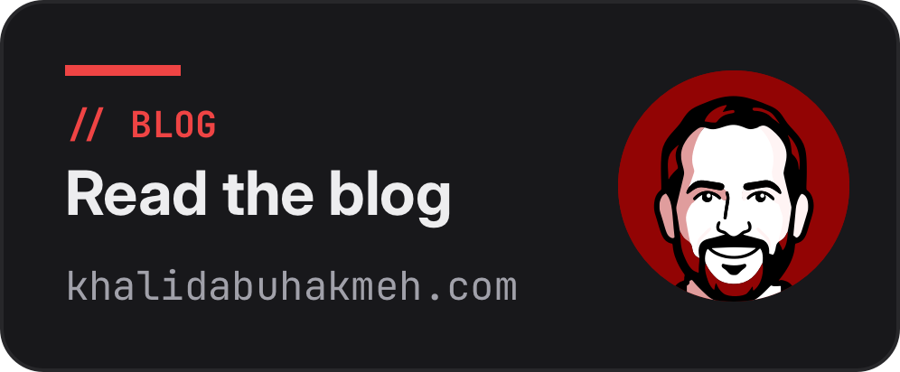

  
  

### Hi there 👋

My name is Khalid Abuhakmeh ([@khalidbuhakmeh][mastodon] on Mastodon). I'm proud of my personal blog at [khalidabuhakmeh.com][blog], where I write mostly about .NET. My posts focus on learning in the open and try to help readers solve problems or grasp ideas. I'm on a tech journey and I hope you come along with me on the ride.

Some of my favorite posts include:

- **[Conditionally Apply LINQ Clauses](https://khalidabuhakmeh.com/conditionally-apply-linq-clauses)**
- **[Use Neo4J to Find The Shortest Path](https://khalidabuhakmeh.com/use-neo4j-to-find-the-shortest-path)**
- **[Writing .NET Database Integration Tests](https://khalidabuhakmeh.com/dotnet-database-integration-tests)**
- **[SQL Polling Listener for Azure SQL and Other SQL Databases](https://khalidabuhakmeh.com/sql-polling-listener-for-azure-sql-and-other-sql-databases)**

### 📙 Blog Posts

<!--START_SECTION:feed-->
- **[Blazor WASM vs Server vs Hybrid: Which Render Mode Should You Use?](https://khalidabuhakmeh.com/posts/blazor-render-modes-wasm-server-hybrid/)**
- **[GitHub Actions Cron: Skip Builds When No Posts Are Due](https://khalidabuhakmeh.com/posts/skip-scheduled-static-site-builds-github-actions/)**
- **[How to Loop Through a List in C#: Every Way, Benchmarked](https://khalidabuhakmeh.com/posts/how-to-loop-through-a-list-in-csharp/)**
- **[Localize Minimal API Validation Messages in .NET 11](https://khalidabuhakmeh.com/posts/minimal-api-validation-localization/)**
- **[Collection Expression Arguments Fix the Comparer Problem in C# 15](https://khalidabuhakmeh.com/posts/collection-expression-arguments-csharp-15/)**
- **[Swap System.Text.Json for REDox in a Minimal API](https://khalidabuhakmeh.com/posts/swap-system-text-json-for-redox-minimal-api/)**
- **[C# 15 Union Types: Build Serializable Workflows](https://khalidabuhakmeh.com/posts/csharp-15-union-workflows/)**
- **[Directory.Build.props: Share Settings Across .NET Projects](https://khalidabuhakmeh.com/posts/directory-build-props-share-settings-across-dotnet-projects/)**
- **[Convert a String to an Int in C#](https://khalidabuhakmeh.com/posts/convert-a-string-to-an-int-in-csharp/)**
- **[Rails to ASP.NET Core: A Developer's Map](https://khalidabuhakmeh.com/posts/rails-developers-map-to-dotnet/)**
<!--END_SECTION:feed-->

### 🗃 OSS

I also [do OSS](https://www.nuget.org/profiles/khalidabuhakmeh) when the time allows. Some of my most popular NuGet packages include:

- [Htmx.NET](https://github.com/khalidabuhakmeh/htmx.net)
- [ConsoleTables](https://github.com/khalidabuhakmeh/consoletables)
- [Codez](https://github.com/khalidabuhakmeh/codez)

I have also contributed logos to multiple .NET ecosystem projects like [Marten](https://github.com/JasperFx/marten), [DDay.iCal](https://github.com/rianjs/ical.net), and [Buildalyzer](https://github.com/daveaglick/Buildalyzer).

### Personal 😜

Fun Facts: 

- My wife, Nicole, and I love traveling.
- I'm currently trying to learn Japanese. おはようございます。(Good Morning!).
- I have two dogs named Samson and Guinness
- I have **[KhalidForAmerica.com](https://khalidforamerica.com)** which points to my blog, and other domains.
- I enjoy Synthwave music.

If you would like to reach me, the best way is on Mastodon via <a rel="me" href="https://mastodon.social/@khalidabuhakmeh">@khalidabuhakmeh</a>.

[blog]: https://khalidabuhakmeh.com                                                                    
[mastodon]: https://mastodon.social/@khalidabuhakmeh
[dotnet]: https://dot.net

<!--
**khalidabuhakmeh/khalidabuhakmeh** is a ✨ _special_ ✨ repository because its `README.md` (this file) appears on your GitHub profile.

Here are some ideas to get you started:

- 🔭 I’m currently working on ...
- 🌱 I’m currently learning ...
- 👯 I’m looking to collaborate on ...
- 🤔 I’m looking for help with ...
- 💬 Ask me about ...
- 📫 How to reach me: ...
- 😄 Pronouns: ...
- ⚡ Fun fact: ...
-->
